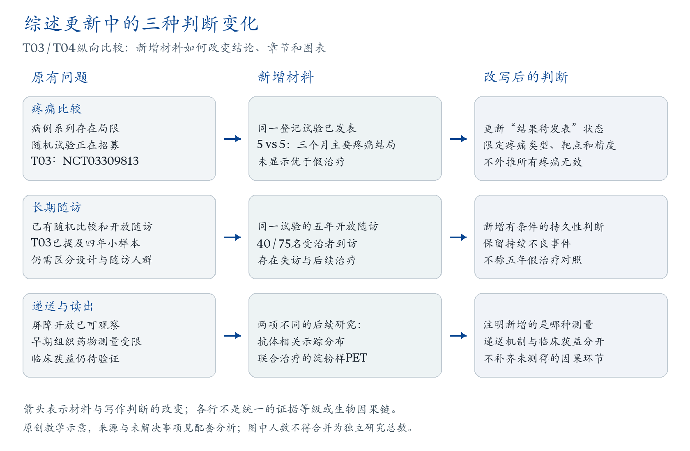

# 用跨案例比较改变写作决定

本页处理四类具体任务：同一技术面对不同读者时怎样排章节；旧综述怎样随证据改变判断；同一研究怎样服务不同体裁；互补来源怎样落实为篇幅、段落和图表。先读与你当前问题对应的一节，再回到自己的证据。这里的医学结果属于各自历史案例，不是新主题可直接沿用的结论。

本页为原创方法分析。D表示来源直接支持，I表示基于来源的解释或写作方案，U表示未核实；它们不是质量等级。主张ID可在[source-claims.csv](source-claims.csv)检索，页段和研究身份分别见该表、[来源连接](claim-source-map.csv)及[书目身份](source-identities.csv)。链接可解析不等于原文已读或方法已验证。

## 一、同一技术，怎样形成不同的章节主轴

**触发。** 提纲只有机制、疾病或设备名称，不能说明读者读完每节能作出什么判断。适用规则为T01-RUL01、T02-RUL01。

T01以机械效应的治疗用途展开，T02从神经科学的观测与干预任务展开。两者都有物理背景；背景分类并不必然就是正文目录。T01 Table1允许用途交叉，T02又单列与超声相互作用的器件。不能把差别简化成“机制综述对应用综述”，也不能由共用超声这个词推出相同因果角色。依据：T01 PDF2–3／正文1–2、PDF9／正文8；T02 PDF1–3／93–95、PDF12–13／104–105；T01-C01、C05，T02-C01、C06（D）。读者任务怎样决定篇幅是分析者的解释（I），并非作者未披露的心理记录。

先用两列整理同一证据组：实际测了什么；它能改变哪个章节判断。下面是可直接修改的原创工作表。

| 实际证据 | 工具选择问题中的去向 | 治疗用途问题中的去向 | 不可偷换的判断 |
|---|---|---|---|
| 特定条件下的任务相关血流动力学读出 | 成像章中心证据，解释读出、参照和声学接近条件 | 与定位或监测相关时进入背景／技术框 | 血流代理不能直接写成细胞放电或治疗获益 |
| 抗体相关示踪分布 | 干预工具的验证环节 | 递送用途中的物质分布证据 | 影像示踪不等同组织浓度，也不等同疾病结局 |
| 取样组织的药物浓度 | 说明特定工具做到的测量层级 | 递送测量段，但按物质、取样位置和流程分层 | 不同研究的示踪与浓度不能合为一个通用递送效应量 |
| 概念性的多维性能地图 | 提醒比较维度，随后查对应条件下的实测研究 | 仅在它解释定位、控制或测量时展开 | 示意图位置不能替代统一条件的性能比较或临床比较 |

表内去向是I级写作选择，不表示每篇母文实际引用了所有来源。fUS依据T02-C155、C179、C199，分别涉及Bimbard／Blaize报告；递送依据T01-C09、C10，分别涉及Meng2021与Sonabend2023。原始图表和未读附件的范围保留在来源记录；Blaize正式XML的核读不能写成正式PDF分页已核。T02 Fig2的近似能力范围也不能改写为共同实验中的排名。

**同证据组的工具段落。** 超声工具应按实际任务与测量对象区分。功能超声在特定接近条件下提供任务相关的血流动力学读出，对神经活动的解释仍依赖神经血管关系与参照测量。递送研究则回答物质到达靶区的另一类问题；抗体相关示踪分布与取样组织中的药物浓度具有不同量纲和限制。工具选择因此需要同时说明任务、实际读出和验证阶段，不能按共有技术名称或一张性能示意图排序。

**English.** Ultrasound tools should be distinguished by the tasks they perform and the quantities they measure. Functional ultrasound provides task-related hemodynamic observations under specified access conditions; interpretation as neural activity depends on neurovascular relationships and reference measurements. Delivery studies address a different question, with antibody-associated tracer distribution and sampled tissue drug concentrations providing distinct measurements. Tool selection therefore requires the task, measured output, and validation stage, rather than a ranking based on a shared technology label or a conceptual performance map.

**同证据组的治疗段落。** 对脑递送用途，应分别评价屏障通透性、物质分布、组织药物浓度和疾病结局。标记抗体影像与组织取样扩展了可观察的递送环节，但物质、取样位置和研究流程的差别限制了定量合并；疾病获益仍需独立的临床证据。成像和监测性能只有在解释定位、控制或测量时进入该论证，不能替代患者结局。

**English.** Brain-delivery applications require separate evidence for permeability, molecular distribution, tissue drug concentration, and disease outcomes. Radiolabelled-antibody imaging and tissue sampling expand the delivery measurements available, but differences in substances, sampling sites, and procedures limit quantitative combination. Disease benefit remains a distinct clinical question. Imaging and monitoring performance informs this argument when it establishes targeting, control, or measurement, rather than substituting for patient outcomes.

两段以同一已知证据组作不同组织，均为分析者的教学写作。时间情景固定为2024-08-07，不能冒充T02在2020年已经可以写出的段落。工具段落的出口是“能测什么、在何种条件下可用”，治疗段落的出口是“用途验证到了哪一步”；相应章节权重随之改变。若只是改了标题，却仍将不同测量合为一个效果，这个方法没有发挥作用。涉及超声供能的组合系统时，还应区分声学接口与实际产生生物作用的模块；后来的器件论文不能用作早期母文的漏引证据。

## 二、更新综述时，先更新判断，再安排新增篇幅

**触发。** 新论文很多，提纲却只是在旧结论后追加引文。适用规则为T04-RUL02；与T03-RUL04的关联案例边界合用。

T03与T04有主题、作者、来源及图形沿用关系。T03在线于2020-10-26，T04卷期为2026-02-18；T04的DOI年份不能反推作者截止。T03已经讨论开放长期观察，不能为了强调进展而把旧文描述成只有短期结果。图1沿革也包含重新选取早期事件，新增节点未必是新发表的发现。（D：T03 PDF3–6／9–12；T04 PDF2–3／602–603、PDF7／607；T04-C06。）

| 新材料与旧材料的关系 | 应改变的文字或结构 | 必须保留的限定 | 失效表现 |
|---|---|---|---|
| 旧文列出的待发表比较已有结果 | 把“等待比较”改为对实际比较的解释；出口问题随结果改变 | 研究身份、人群、主要终点、精度 | 只加论文，继续沿用旧状态；或把未显著写成普遍无效 |
| 同一试验延长随访 | 在持久性节补充到访人群、阶段设计、后续治疗及持续事件 | 原随机阶段与解盲／交叉后的开放观察分开 | 把新报告计为独立复制，或称长期仍有原随机对照 |
| 增加不同测量 | 新设或调整测量层级，解释新增信息和缺失连接 | 不同物质、模型、读出和结局不得互换 | 把代理指标自动连成患者获益 |
| 图中重选事件或改用统计口径 | 同步调整图注、阶段标记与正文判断 | 图的删除不等于研究被否定；年度与累计不可直接拼接 | 仅增加节点，或把研究数量解释为疗效增长 |

**完整例子：等待比较证据之后。** T03在疼痛节列出NCT03309813；后来的单中心报告纳入十名神经病理性三叉区域疼痛患者，五名治疗、五名假治疗，三个月主要疼痛结局未显示优效。综述因此可以从等待比较证据转向解释已完成的比较，但小样本、特定表型及靶点限制了精度和外推。次要终点或个体影像不能替代主要结果，也不能据未显著推定所有疼痛应用效果为零。章节由非对照信号进入明确比较，再以人群、终点及设计问题收束。母文T04的“多中心”不沿用；单中心身份据原报告及登记。（T04-C-ISHAQUE24-RCT、T04-C-ISHAQUE24-ENDPOINT；母T03 PDF6／12，母T04 PDF7／607。）

**English.** T03 identified an ongoing randomized trial while discussing the limitations of early pain studies. The subsequent single-centre report enrolled ten participants with trigeminal neuropathic pain and did not show superiority over sham on the primary pain outcome at three months. This changes the review from awaiting a comparison to interpreting a completed comparison. The small sample, selected phenotype, and target limit precision and generalizability; secondary outcomes or individual images cannot replace the primary result. The section should therefore move from uncontrolled signals to comparative evidence and its scope, without inferring zero effect across all pain applications.

**同一方法怎样处理延长随访。** T04-R016来自既有试验家族，五年到访40/75名受治者；该阶段是开放随访，不能写为五年假治疗比较。部分指标相对基线改善与持续不良事件应同时保留，且不能将75名患者、77次程序或40名到访者当同一分母。（T04-C-ET5YEAR2022、T04-C-ETSAFETY5YEAR2022。）

**新增测量的边界。** Mainprize研究的屏障代理和有限药物取样、Meng的抗体相关示踪、Rezai联合治疗的区域PET分别增加不同信息；它们不是同一队列的连续证据链。Mainprize的定量影像、取样数和检测范围有明确限制；Rezai报告不直接测抗体浓度，也不能据区域PET变化证明认知获益。（T04-C-MAINPRIZE19-CLOSURE、T04-C-MAINPRIZE19-DRUG、T04-C-TRASTUZUMAB、T04-C01、C02。）

[可编辑SVG](../assets/update-logic.svg)。本图是原创方法教学图；箭头表示材料状态与综述判断的改变，不表示生物因果链、可合并效应量或统一的证据升级。疼痛行连接同一登记研究；长期随访行保留T03已有长期观察的事实；递送行来自不同研究。图中文字和形状可编辑，无第三方原图。来源为本节列出的原有主张及页段。

输出应是“旧判断—新增材料—新判断—章节／图表改变”，而非新增文献数量。若旧判断仍成立，也可以明确保留而无需强行重排。T03/T04均参与规则归纳，不能互作未见题验证。

## 三、同一研究在不同体裁中怎样被使用

**触发。** 两篇综述似乎对同一研究意见相反，或把参考文献表直接当作纳入研究清单。适用规则为T09-RULE05、T10-RULE04；筛查链解释与T10-RULE02合用。

T09的Seminar覆盖疾病负担、机制、识别与管理；T10的证据报告按筛查、转诊、准确性、治疗与损害的关键问题组织。T09首页披露主检索2000-01-01至2022-07-31、不限语言、近五年优先与经典例外；T10主检索至2021-02-09、监测至2022-01-21，另承接旧版合格研究。它们有不同可观察方法，不能替T09编造完整筛选日志，也不能把T10的英语或设计限制强加于所有综述。

**先对齐LiGHT，再解释差别。** 该研究为718名初治OAG／OHT患者的管理策略比较，并允许重复激光及按需升级。三年一般生活质量主要终点的调整差为0.01（95%CI −0.01至0.03），未证实激光优先的优势；36个月有临床资料的314名激光组患者中233名免滴眼液仍达目标，为74.2%。进展、手术等眼级过程结果与主要终点分开。（T09-C07、T10-C09；原报告Table4–6，刊页1510–1513。）

T09在治疗节强调管理收益，但对视野保留的概括须保留次要终点与分析单位；T10在KQ10–11强调所列终点相近，但相近不等于经预设界值证明等效，也不意味着所有过程收益都相同。两者的任务差异能解释部分强调差别，不能免除任何一篇过强表述的责任。2019正式更正需与原报告关联，作者实际何时知晓仍未知。

**管理章节的综合。** 初始治疗选择需要同时看疾病控制、治疗负担与患者相关结局。LiGHT的主要一般生活质量终点未显示明确优势，但部分有随访资料的激光组患者可在不使用滴眼液的情况下达标，过程及英国眼专科费用结果也具有决策意义。这支持讨论管理路径的取舍，不能直接改写成确定的长期视野保护或人群筛查净获益。

**English.** Initial treatment selection involves disease control, treatment burden, and patient-relevant outcomes. LiGHT did not demonstrate superiority for its primary generic quality-of-life outcome, while many laser-first participants with follow-up data met pressure targets without drops, and pathway and UK ophthalmology cost outcomes informed the decision. These findings support a discussion of treatment-strategy trade-offs without establishing a general long-term visual-field benefit or the net benefit of population screening.

**筛查章节的综合。** 治疗研究补充的是筛查路径中的一个环节。即使已识别人群中存在治疗收益，也仍需说明发现、转诊完成、治疗获得与持续照护如何连接健康结局及损害。准确性、治疗效果与整体筛查结论不能互相替代；同时，证据链尚不完整并不证明所有筛查方案无效。

**English.** Treatment studies inform one component of a screening pathway. Benefits in identified patients do not by themselves establish how detection, completed referral, access to treatment, and sustained care affect health outcomes and harms in the screening population. Accuracy, treatment effects, and overall screening conclusions therefore require separate judgments. An incomplete evidence chain also does not demonstrate that every screening programme is ineffective.

前段适合“初始管理策略”，后段适合“从环节证据到筛查判断”的讨论。T10 Figure1的箭头表示问题关系，不是已证实的因果关系；T09 Figure3的疾病变化示意不是个体纵向轨迹。用图时要保留它究竟在解释什么。

**被引用但未纳入的实际例子。** Aspberg长期观察研究在T10 PDF2／1999被引用以说明监测期发现后的排除，并非83项纳入研究之一。原研究做过年龄／随访匹配及自选择处理；应如实保留这些步骤，同时说明构建对照和混杂控制的限制。不能说完全没有任何校正，也不能据有校正就视为随机证据。（T10-C08、C49–C51；原文目标文章在合订文件PDF69–79／106–116，只有这11页计为目标全文。）

关系层应分别记录“被检索到”“被引用”“按哪个问题纳入”“承担什么功能”。一个报告可服务某一问题而不适用另一问题；不宜只给它贴一个永久的纳入／排除标签。作者没有披露筛选记录时，未知就是未知，不能把未引用推成明确排除。

## 四、从互补证据到篇幅、段落和图表

**触发。** 已有来源和证据表，但正文仍逐篇介绍研究，或每段只剩限制而没有科学判断。先确定这一节要回答的问题，再为每份来源指定必要的论证职责，最后决定展开、压缩、并列或转介。下面的取舍为本项目的I级写作分析；原研究的测量与母综述的引用位置是D，未公开的选文动机仍为U。

| 需要解决的写作问题 | 证据组中的实际分工 | 具体成文选择 | 章节出口 |
|---|---|---|---|
| 工程实现与生物应用混在同一句 | 经骨聚焦中的模型校正、体模场形、椎骨场控制和会议摘要提供不同层次的实现依据 | 完整研究用于解释指标与参照；摘要压缩为另一实现路线。把模型和场形放表，正文写清增加了什么空间能力 | 从“能否到达和塑形”转入相应条件下的组织响应；预印本VOR未核与摘要范围保留 |
| 病理变化、行为任务和组合效果被写成同一改善 | 普通小鼠神经发生为背景；APP23研究同时有病理及任务；tau模型暴露终点差异；单用/组合设计支持特定比较 | 背景一句交代，展开能改变功能或组合判断的比较；先按模型、表位和任务分组，再给出条件明确的判断 | 从已有组织与任务反应进入患者认知和日常功能问题，不假定跨模型因果链已完成 |
| 监测章节只是设备清单 | 在体组织与随访提供参照；剪切波、被动声学和塌陷时间回答不同性能问题；残余泡云解释信号时段 | 比较表保留组织、参照和采集时点；正文综合早期显影、作用位置与局部进展的不同贡献 | 先明确信号含义，再问相对哪个空间目标评价，以及是否支持治疗决策 |
| 后续论文被自动算作重复验证 | R157给R156既有电导数据增加声学分析；R158约束界面解释；R159比较中/高频条件和恢复 | 把R156/R157写成增量分析，模型与新条件各占相应位置；恢复另按实测窗口和外推区分 | 从运输终点到屏障/声学读出，再进入实际递送与恢复时长的联系 |

表注：原创可编辑的证据职责表，不是跨研究效能排名。某项来源在此压缩为背景，可能在以工程或机制为主问题的另一篇综述中成为核心。R156图6/7虽已查看，但染色区域辨认受限，其空间差异仍归属于作者报告；R159的恢复方向在源内不一致，不能借此选择确定的频段优劣。

**来源与页段。** 下列ID均可在[source-claims.csv](source-claims.csv)检索，并经[来源连接](claim-source-map.csv)与[书目身份](source-identities.csv)回到所读版本：

- 经骨：T01-BONE-C02（源PDF9–10／91–92；母T01 PDF3／正文2）；T02-BONE-C01、T02-BONE-C02（所读预印本PDF6–10，VOR未核；母T02 PDF10／102）；T08-BONE-R149-C01（会议汇编PDF27／3954）；T08-BONE-R150-C01、T08-BONE-R150-C02、T08-BONE-R150-C03（源PDF3、5–9／2324、2326–2330；母T08 PDF11／505）。
- 病理与功能：T01-PATHFN-R038-C01（源PDF1–3／304–306）；T01-PATHFN-R039-C01（源PDF2–10，Figs1–7）；T01-PATHFN-R042-C01、T01-PATHFN-R042-C02（源PDF3–13／3756–3766）；T01-PATHFN-R043-C01、T01-PATHFN-R043-C02（源PDF3–10／1222–1229）；母T01主要位置为PDF4／正文3。
- 组织与监测：T06-C-MON103-IMAGE（源PDF4、9–10／1240、1245–1246）；T06-C-MON104-REPAIR、T06-C-MON104-MRI（提供作者稿PDF7–11、18–23，稿页同，VOR未核）；T06-C-MON105-COMPARISON（PDF7、9–11／1173、1175–1177）；T06-C-MON106-CLASSIFICATION、T06-C-MON106-SCOPE（PDF2–7／107–112）；T06-C-MON107-PROGRESSION、T06-C-MON107-PLATEAU（PDF8–12／文章7–11）；T06-C-MON108-RESIDUAL、T06-C-MON108-INTERPRETATION（PDF7–11／文章6–10）；母T06位置为PDF10–11／150–151。
- 经皮递送：T08-SONO-R156-C03（源PDF3–7／1696–1700）；T08-SONO-R157-C03（PDF4／447及PDF10／453，ref36）；T08-SONO-R158-C03（PDF9–11／3510–3512）；T08-SONO-R159-C01、T08-SONO-R159-C03（PDF1–9、11／266–274、276）；母T08位置为PDF12／506。R156与R157共享含SLS的离体猪皮体系的电导数据；R157新增声学测量主要使用PBS。声学与电导结果是跨条件关联，并非逐个皮肤样本的同步配对验证。

**由表到科学正文：监测实例。** 不同读出增加了对组织状态与作用过程的互补信息。离体肾中，剪切波弹性改善了早期病灶对比，但其与完整细胞核参照的拟合并未全面优于背散射。仿体被动空化成像在固定深度方位线上的液化区分类AUROC和敏感度高于延后采集的B模，优势限于该内部比较，尚未接受独立测试。声学与光学塌陷时间的变化相符，且前者与中央红细胞层分解进程相关，支持局部进展读出；中央平台后外围仍可变化，因而平台不能单独界定全病灶完成。残余泡云灰度又随时间和成像作用而变。这些结果分别支持早期显影、作用位置和局部进展的技术判断，组织参照与采集时点是解释其用途的组成部分。

**Independent English synthesis.** Different readouts provide complementary information about tissue state and process dynamics. In ex vivo kidney, shear-wave elastography improved early lesion contrast, although its association with intact nuclear structure did not outperform backscatter across all measures. In phantoms, passive cavitation imaging achieved higher AUROC and sensitivity than delayed B-mode imaging for classifying liquefied regions along a fixed-depth line; the advantage was established within that dataset, without independent testing. The close correspondence between acoustic and optical collapse-time measurements, together with the association between acoustic collapse time and progression in the central red-cell layer, supports a local progression readout. Peripheral change can continue after the central signal plateaus, so that plateau does not by itself define completion of the whole lesion. Residual-cloud brightness also evolves with time and can be affected by imaging. These findings support distinct judgments about early visibility, action location and local progression, whose interpretation depends on tissue references and acquisition timing.

**为什么这样安排。** 这段以监测任务为主位，三种主要读出构成比较，残余泡云承担解释性背景。它没有按每篇论文各写一段，也没有复述表中全部数值。下一节可进入“观测区域与计划、病灶或靶结构是否一致”，再讨论实际应用结局；若目标读者主要比较设备实现，也可保留模态章节，在各节内按同一组任务解释性能。

**迁移时的操作。** 在自己的候选或证据表上写出来源的职责，并检查该职责是否出现在实际段落和章节出口中。相似论文若只是重复背景，可以压缩；若增加独立复制、改变比较或解释分歧，应在判断中体现这个增量。若正文只有“存在限制”，先返回证据找出仍能成立的正面判断；若材料确实不足以支持所问结论，就把未知精确定位到该判断，不补造结论。此操作沿用D1、D3—D7相关入口，不新增规则或验证次数。

## 五、怎样判断方法是否真的起作用

| 可观察产物 | 达到的方法目标 | 不能据此宣称 |
|---|---|---|
| 章节卡写清入口、证据与出口，且同一证据在不同任务中有合理权重 | 结构选择能够追溯到读者问题 | 所有综述都应采用同一框架 |
| 新材料改变了具体谓语、设计身份、分母或后续问题 | 综述完成论证更新 | 新年份或更多报告必然提高确定性 |
| 共享研究的差异被拆成终点、时间、单位与用途 | 能区分合理强调和真正过度解释 | 体裁不同可以原谅错误 |
| 被引、纳入与研究家族分开记录 | 选文与计数依据可复核 | 已重建作者真实看过的全部文献库 |

本页将既有规则落实为写作选择与可检查的成品，不增加规则条数，也不增加原始阅读计数。适用性仍是候选：系统综述不能为叙事便利临时改变纳排；技术测量综述不必强套完整筛查链；若已有适用的整体路径直接比较，也不必要求每个中间环节独立随机后才承认整体结果。

迁移评价须冻结新版本、任务、资料与标准，在相同原始材料和资源条件下比较普通指令与启用技能的实际输出。使用过的训练案例、已用于修订的测试题及高度重复的研究家族，不作为新未见证据。各版本实际测试与运行范围见[验证状态](../evals/validation-summary.md)；[0.3.2历史方案](../evals/protocol-v032.md)保留其原版本归属。计划、文件检查和本页训练案例均不等于本次修订的未见题效果验证。
